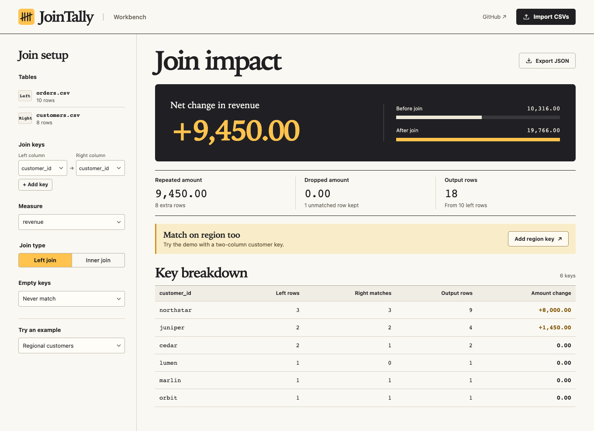

# JoinTally

**Find out what a join will double-count or drop before you run it.** Give JoinTally two CSVs, the join columns, and a numeric measure. It computes the output row count and shows exactly how much each key adds or removes from the total.

[Open the browser workbench](https://abhishekpundir23.github.io/jointally/) · [Try the offsetting-errors demo](https://abhishekpundir23.github.io/jointally/#balanced) · [Download for offline use](https://github.com/Abhishekpundir23/jointally/releases/download/v0.1.0/jointally.html)



## The join that passes both checks

Three orders total **250.00**. An inner join returns **three rows** that also total **250.00**. Both checks pass. Here's what happened to the orders:

| Customer | Order amount | Customer records matched | Amount in result |
| --- | ---: | ---: | ---: |
| a | 100.00 | 2 | 200.00 |
| b | 100.00 | 0 | 0.00 |
| c | 50.00 | 1 | 50.00 |

JoinTally reports **100.00 repeated**, **100.00 dropped**, and the keys responsible. Its optional CI check catches this even when the changes cancel within a single key.

## Try it

**Browser.** Open the workbench, then click **Add region key** in the regional customer example. Watch the extra 9,450.00 disappear. Use **Import CSVs** to try your own files. Processing happens in your browser. The offline download is a single HTML file you can open by double-clicking.

**Terminal.** With Node.js 20 or newer, run the tagged CLI directly:

```sh
npx --yes https://github.com/Abhishekpundir23/jointally/releases/download/v0.1.0/jointally-0.1.0.tgz demo --scenario balanced
```

Or clone the repository. The CLI has zero runtime dependencies.

```sh
git clone https://github.com/Abhishekpundir23/jointally.git
cd jointally
node bin/jointally.mjs demo
node bin/jointally.mjs examples/orders.csv examples/customers.csv \
  --key customer_id --key region --measure revenue
```

The example starts with 10 orders totaling 10,316.00. Some customers have one directory entry per region. Joining on customer ID alone yields 18 rows totaling 19,766.00. Including region restores all 10 original amounts. One order still lacks a customer record and the left join keeps it.

## Reproduce it on the Chinook sample database

Chinook has 412 invoices totaling **2,328.60**. Joining them to 2,240 invoice lines and summing the invoice total produces **20,848.62**. JoinTally attributes **18,520.02** to repeated amounts. Invoice 404 alone contributes 25.86 fourteen times. A native SQLite join returns the same row count and total. [Chinook database snapshot](https://github.com/lerocha/chinook-database/blob/7f67772503d71ba90f19283c38e93923addb43fa/ChinookDatabase/DataSources/Chinook_Sqlite.sqlite)

<details>
<summary>Run the case with SQLite and Node.js</summary>

From the JoinTally repository, with the linked database downloaded as `Chinook_Sqlite.sqlite`:

```sh
sqlite3 -header -csv Chinook_Sqlite.sqlite \
  "SELECT InvoiceId, printf('%.2f', Total) AS Total FROM Invoice" > invoices.csv
sqlite3 -header -csv Chinook_Sqlite.sqlite \
  "SELECT InvoiceId FROM InvoiceLine" > invoice-lines.csv
node bin/jointally.mjs invoices.csv invoice-lines.csv \
  --key InvoiceId --measure Total --join inner --limit 5
```

</details>

## Use it in a pipeline

```sh
node bin/jointally.mjs orders.csv customer_export.csv \
  --key customer_id=id --measure revenue --join inner \
  --json --fail-on-drift > join-report.json
```

| Option | Behavior |
| --- | --- |
| `--key name` or `--key left=right` | Map columns. Repeat the flag for a composite key. |
| `--measure column` | Audit the sum of this left-table column. |
| `--join left\|inner` | Choose an equality join. Defaults to left for file inputs. |
| `--nulls distinct\|match` | By default, an empty component prevents a key from matching. Use `match` to equate empty fields. |
| `--delimiter comma\|tab` | Set the file separator for both inputs. |
| `--limit N` | Show the top N left-side key groups (default 30). Zero produces only the summary. Totals and drift detection use every row. |
| `--json` | Emit machine-readable results. Decimal amounts are strings to preserve precision. |
| `--fail-on-drift` | Exit 1 if any nonzero source amount is repeated or dropped. A change involving only zero-valued rows is visible in the row counts. |

A successful analysis exits 0 unless the drift check fires. Invalid input or arguments exit 2. The key table ranks groups by absolute change, then by extra rows and key value.

## Check a pull request with GitHub Actions

Once your job has checked out the repository and produced its two CSV files, add this step. A repeated or dropped nonzero amount fails the step and leaves the totals in the job summary.

```yaml
- name: Check order revenue
  id: revenue
  uses: Abhishekpundir23/jointally@v0.1.0
  with:
    left: exports/orders.csv
    right: exports/customers.csv
    keys: |
      customer_id=id
      region
    measure: revenue
    join: left
```

Set `fail-on-drift: 'false'` to record the result without failing the job. The action exposes `has-drift`, `before`, `after`, `delta`, and `output-rows` as step outputs. Its summary contains aggregate figures.

## How the calculation works

For each left key, JoinTally sums the measure and counts matching records on the right. Three matches repeat each amount twice. Zero matches keep the amount once in a left join and drop it in an inner join. Across all keys:

```text
after = before + repeated − dropped
```

Refunds and other negative amounts keep their sign. All arithmetic on measures uses scaled integers. Keys compare as literal strings, including case and whitespace. Only an empty field receives the selected empty-key behavior. Measures accept signed base-10 decimals with optional surrounding whitespace. Normalize currency symbols, thousands separators, and scientific notation before importing.

JoinTally models left and inner equality joins over a single **additive** left-side measure. It reads both UTF-8 inputs into memory and groups the left rows by key. It never creates the joined table. Available memory, input row counts, and unique left keys determine how large a dataset fits. Database casts, collations, and additional join predicates can change a real query's result.

## Develop and verify

```sh
npm test                       # engine, CSV parser, CLI, and sample data
python3 scripts/sql_oracle.py  # differential checks against native SQLite joins
npm ci                         # development tools for the browser build
npm run build                  # rebuild the self-contained docs/index.html
npx playwright install chromium
npm run test:browser           # exercise the offline build in Chromium
```

For browser development, serve the repository root with `python3 -m http.server 8000 --bind 127.0.0.1` and open `http://127.0.0.1:8000/web/`. The source lives in [web/](web/), and both interfaces call [the same analyzer](src/analyze.mjs).

Bug reports are easiest to reproduce with two small synthetic CSVs, the key mapping, and the expected totals. Please keep private customer data out of public issues.

[MIT license](LICENSE)
